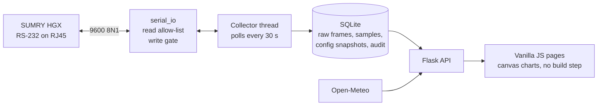

# SUMRY HGX Solar Monitor

A local-first monitor for a SUMRY HGX 4 kW 24 V inverter, running on a Raspberry Pi with no cloud account and no build step. It speaks a reverse-engineered serial protocol, tracks battery health by counting charge, and learns the array's solar potential from its own output.

<p>
  
  
</p>

## What it does

- **Live power flow.** PV, battery, load and utility every 30 seconds, plus the inverter's output stage, bus voltage, temperatures and fans.
- **History charts.** One hour to thirty days on a canvas chart. The API caps a response at a configurable point count, and the chart thins rows to its own pixel width keeping every column's extremes, so the drawn peaks are the real peaks and agree with the summary tiles.
- **Battery bank health.** State of charge by counting charge, re-anchored at full (plateau held at a trickle after a recent absorption) and at rest (C/50 with no charge current). Each full-to-rest stretch measures the bank's effective capacity, which replaces the nameplate. Pre-dawn voltage, absorption time and tail current are shown per day as recovery gauges.
- **Time to the low-voltage cutoff.** Hours left at the recent draw, down to the inverter's configured cutoff rather than to empty, with a warning when no utility is there to fall back on.
- **Solar potential.** Sun position for the site, clear-sky irradiance, Open-Meteo cloud cover, and transposition onto one or two roof faces. The level is learned per band of sun elevation from the array's own unconstrained output. The page shows the shortfall against what was captured and the losses a rewiring would recover.
- **Utility bypass detection.** The frame carries no utility current, so mains use is derived from the transfer relay (the inverter's own output collapses while the load stays) and from the power balance.
- **Admin portal.** Password plus optional PIN. Serial diagnostics, retention, runtime settings, estimator inputs, audit log, exports, and Raspberry Pi controls through a scoped sudo helper.
- **Gated inverter writes.** Off by default. A write is the inverter's own configuration block sent back with only allow-listed fields changed, then read back. Nothing is reported as applied on the strength of having been sent.
- **Change proposals.** `python -m solar_monitor.propose` queues an intent without touching the port. It is released by an admin, or by a policy that can only narrow what the protocol already allows.

## Architecture



A collector thread owns the serial port. Every cycle it sends the status query, stores the raw exchange, and stores the decoded sample. Every tenth cycle it reads the configuration block and stores a snapshot. Approved change requests are applied between polls by the same thread, so nothing else ever opens the port.

Flask serves the JSON API and three pages: the dashboard, the solar potential page, and the admin portal. The pages are plain HTML, CSS and JavaScript loaded with `<script>` tags. Charts are drawn on canvas by `chart-core.js`, which both charting pages share.

The protocol layer (`solar_monitor/protocols/sumry_8851.py`) validates every frame by its trailing CRC16/MODBUS checksum, decodes the 158-byte status frame and the 104-byte configuration frame, and exposes exactly two read queries. `serial_io.py` refuses any outbound frame that is not one of them, and routes writes through a separate gate that only permits the inverter's own last reply with allow-listed bytes changed.

## Safety model

Polling is read-only. Writes are opt-in, and a write must pass three gates before it reaches the port:

1. **Policy.** The admin writes switch defaults to off. A proposal from tooling is applied without a person only when every field it touches is inside the auto-apply policy, which is off and empty by default.
2. **Writable-field table.** Each field has a byte offset, a scale and the range of the inverter's own menu. Anything outside the table, or outside its range, is refused before a frame is built.
3. **Frame assertion.** `assert_write_frame` compares the outbound frame to the reply it was built from and rejects any byte that differs outside the writable masks, any wrong length or command, and any bad checksum.

Writes are whole-block rewrites because the inverter has no per-register write. Command `0x0010` takes the entire 94-byte configuration block, so the safest possible frame is the block the inverter just sent, re-checksummed, with the requested bytes changed. After the write the collector reads the block again and reports each requested value as verified or mismatched. Every write, failure and switch flip is audited.

## Setup

- An RJ45 connector here is **not Ethernet**. Do not plug the inverter COMM port into the Pi's Ethernet port or a network switch.
- Verify the inverter's RJ45 RS-232 pinout and signal levels before connecting. Use a true USB-to-RS232 adapter (not a TTL UART), cross TX and RX as required, and connect signal ground. Leave unused voltage pins unconnected.
- Keep the inverter disconnected from mains and PV while assembling or changing the breakout wiring, following its manual and normal electrical-safety practice.

```sh
sudo apt update
sudo apt install -y python3-venv avahi-daemon nginx
python3 -m venv .venv
.venv/bin/pip install -r requirements.txt
cp config.example.toml config.toml
sudo usermod -aG dialout "$USER"   # then log out and in
```

Before running the collector, confirm the wiring with the diagnostic tool. `--listen-only` transmits nothing; without it the tool sends only the two allow-listed read queries.

```sh
.venv/bin/python diagnostic.py --listen-only --timeout 3
.venv/bin/python diagnostic.py --json-log captures/hgx.jsonl
```

For a no-port URL, set the hostname to `solar-monitor`, enable Avahi, and install `deploy/nginx-solar-monitor.conf` as the default nginx site (its header has the commands). `deploy/solar-monitor.service` assumes `/opt/solar-monitor`, a `solar-monitor` service account and `/var/lib/solar-monitor` for the database; adjust the paths for your installation.

## Configuration

`config.toml` is untracked. Copy `config.example.toml` and edit it.

| Table | Keys |
| --- | --- |
| `[serial]` | `port` (`"auto"` picks the first USB adapter), `baudrate`, `timeout_seconds`, `poll_seconds`, `protocol` |
| `[web]` | `host`, `port` |
| `[storage]` | `database` (SQLite path; its directory also holds the secret and setup-token files) |
| `[site]` | `latitude`, `longitude`, `array_capacity_watts`, `performance_ratio`, `tilt_degrees`, `azimuth_degrees`, `dual_slope`, `split_strings`, `array_description`, `module_count`, `module_watts`, `wiring`, `vmp_volts`, `voc_volts`, `imp_amps`, `isc_amps`, `inverter_model`, `charge_limit_amps`, `battery_description`, `battery_nominal_volts`, `battery_capacity_ah` |

Every `[site]` key is optional. Without a location and array capacity the solar estimator is off and the potential page says so. `performance_ratio` is only the fallback until a week of readings exists; after that the level is learned. `dual_slope` splits the array across both faces of a pitched roof; `split_strings` says each series string straddles both faces.

Settings changed in the admin portal (polling rate, retention, chart point cap, estimator inputs, writes switch, auto-apply policy) are stored in SQLite and take effect without a restart.

## Run

```sh
.venv/bin/python run.py --config config.toml          # serves with waitress
.venv/bin/python run.py --config config.toml --dev    # Flask's development server
.venv/bin/python run.py --no-collector                # web UI only, no serial polling
.venv/bin/python run.py --demo                        # no hardware: a simulated inverter
```

`--demo` runs everything against a simulated HGX reached through a pyserial `sim://` port, with a week of generated history, at `http://127.0.0.1:5000`. The admin portal login is `demo` / `demo-password`.

Open `http://solar-monitor.local:5000`, or `http://solar-monitor.local` behind nginx. On first run visit `/admin/setup?token=...` with the token from the `setup-token` file next to the database to create the admin account.

## Endpoints

Public:

| Method | Path | Returns |
| --- | --- | --- |
| GET | `/`, `/estimate` | dashboard, solar potential page |
| GET | `/api/status` | latest sample with the derived utility state, latest configuration, last raw exchange, collector state |
| POST | `/api/refresh` | one immediate poll, rate-limited to once per 5 seconds |
| GET | `/api/history?hours=N&fields=a,b&points=N` | samples for the last N hours (max 720), optionally only the named columns |
| GET | `/api/history/daily?days=N` | per-day averages, peaks and minimum battery voltage |
| GET | `/api/history/faults?days=N` | rows with a non-empty faults field |
| GET | `/api/battery` | charge count, anchors, measured capacity, runtime to cutoff, 14 days of health |
| GET | `/api/estimate?hours=N` | modelled output for the window plus six hours ahead, calibration, scenarios |
| GET | `/api/system` | Pi uptime, network, CPU temperature, throttling, eco mode |
| GET | `/health` | process and collector health |

Admin (session required; `/admin/setup`, `/admin/login`, `/admin/pin-login` and `/admin/logout` manage the session):

| Method | Path | Does |
| --- | --- | --- |
| GET | `/admin` | the portal |
| GET | `/api/admin/overview` | ports, settings, storage counts, disk, system snapshot |
| GET, POST | `/api/admin/settings` | read or change runtime settings |
| POST | `/api/admin/serial/listen`, `/api/admin/serial/probe` | passive capture, or one allow-listed status query |
| GET | `/api/admin/frames?limit=N` | recent raw exchanges |
| POST | `/api/admin/data/cleanup` | run retention now |
| GET | `/api/admin/audit` | recent audit events |
| GET, POST | `/api/admin/security` | PIN status; set or disable the PIN |
| GET | `/api/admin/inverter` | writes switch, current configuration, writable fields, snapshots, proposals, policy |
| POST | `/api/admin/inverter/writes` | switch writes on or off |
| POST | `/api/admin/inverter/settings` | write changed fields and read them back |
| POST | `/api/admin/inverter/restore` | write an earlier snapshot back |
| POST | `/api/admin/inverter/requests/<id>/approve`, `.../reject` | decide a proposal |
| POST | `/api/admin/inverter/auto-apply` | switch and edit the auto-apply policy |
| GET, POST | `/api/admin/system/eco` | read or set the CPU governor |
| GET, POST | `/api/admin/system/wifi` | scan, or connect to a network |
| POST | `/api/admin/system/restart-service`, `/api/admin/system/reboot`, `/api/admin/system/update-check` | Pi controls |
| GET | `/api/admin/export/frames.jsonl`, `/api/admin/export/samples.csv` | exports |

## Raspberry Pi controls

The portal's Raspberry Pi tab can toggle the CPU governor, restart the service, reboot, and scan or join Wi-Fi networks. All of these run through one helper, `deploy/pi-control.sh`, which never evaluates its arguments as shell and accepts only a fixed set of actions. A Wi-Fi passphrase reaches it on standard input rather than as an argument, because sudo logs every argument to the system journal. To enable them:

1. Install the sudoers rule, adjusting the user and path: `sudo cp deploy/solar-monitor-sudoers.example /etc/sudoers.d/solar-monitor && sudo chmod 440 /etc/sudoers.d/solar-monitor && sudo visudo -c`. The rule grants root to whatever the script contains, so the script and every directory above it must be owned by root and not writable by the service account. A root-owned `/opt/solar-monitor` run by a separate user is fine; a checkout in the service user's home directory is not.
2. Make sure the systemd unit does not set `NoNewPrivileges=true`; it blocks `sudo` regardless of sudoers. The shipped unit leaves it off.
3. Wi-Fi actions need NetworkManager (`nmcli`), the default on Raspberry Pi OS Bookworm and later.

Without this setup the buttons return a clear error instead of hanging.

## Tests

```sh
.venv/bin/python -m unittest discover -v
```

There is no browser or JavaScript engine on the Pi, so a mistake in a page script cannot surface at runtime the way a Python exception does. The suite compensates statically: every template must supply the DOM ids its script resolves at load time, scripts must have balanced brackets, and shared modules must load before their consumers.

Node.js is optional and development-only. When it is present the suite also parses every script with V8 and runs the charting unit tests in `tests/js/`; when it is absent those two tests skip. To run the JavaScript tests alone: `node --test tests/js/*.test.js`. They use Node's built-in runner and add no dependencies.

## Project layout

```text
run.py                                 web server plus background collector
diagnostic.py                          serial discovery and raw capture tool
solar_monitor/config.py                config.toml loading
solar_monitor/collector.py             polling thread, write path, applying approved proposals
solar_monitor/serial_io.py             guarded 9600 8N1 transport, read allow-list, write gate
solar_monitor/protocols/base.py        protocol interface
solar_monitor/protocols/sumry_8851.py  HGX 0x8851 frames: CRC, decoders, writable fields
solar_monitor/db.py                    SQLite schema, history, retention, proposals, audit
solar_monitor/web.py                   Flask routes: public API and admin portal
solar_monitor/battery.py               charge counting, anchors, capacity, runtime to cutoff
solar_monitor/utility.py               utility presence and bypass from the power balance
solar_monitor/solar_estimate.py        sun position, irradiance, roof geometry, learned efficiency
solar_monitor/change_policy.py         auto-apply policy evaluation
solar_monitor/propose.py               command-line change proposals
solar_monitor/privileged.py            calls into the scoped sudo helper
solar_monitor/system_info.py           Pi uptime, temperature, network, service state, updates
solar_monitor/security.py              secret and setup-token files
solar_monitor/templates/               dashboard, solar potential, admin and login pages
solar_monitor/static/                  vanilla CSS and JavaScript; chart-core.js is shared
tools/discover_registers.py            map unknown configuration registers from panel changes
tools/screenshot.py                    render the pages with headless Chromium
deploy/                                systemd unit, nginx site, sudo helper and rule, example config
tests/                                 protocol safety, models, API and front-end static checks
tests/js/                              Node unit tests for the charting maths
docs/decisions.md                      why the code is the way it is
```

## Decisions

The reasoning behind the non-obvious choices (why offset 76 is not utility current, why a rest anchor is C/50, why efficiency is an envelope per sun band, why writes are whole-block rewrites) is recorded with its evidence in [docs/decisions.md](docs/decisions.md).

## Status and known limitations

- The `operating_state` and `faults` bytes of the status frame are not yet identified, so the fault history is empty until they are.
- Utility current is not available from the frame. The utility watts and amps shown are derived from the power balance and are a lower bound, not a metered reading.
- Battery type cannot be read or written over the protocol. The bits that appeared to hold it were disproven against the front panel, so it must be set on the inverter's own menu.
- The models are calibrated on one installation: a 24 V Odyssey AGM bank, a 2.64 kW array split across a gable roof, and a desert site. The chemistry curve, anchor thresholds and ground albedo are constants in the code.
