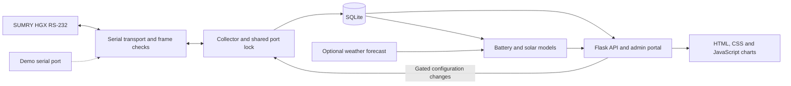

# SUMRY HGX Solar Monitor

[](https://github.com/AbdelRahmanBouri/sumry-hgx-solar-monitor/actions/workflows/ci.yml)
[](LICENSE)

A Raspberry Pi monitor for a SUMRY HGX 4 kW, 24 V inverter. It shows where solar power is going, keeps a local history, and estimates battery charge and unused solar output. The aim is to make one household installation easier to understand and investigate, with raw serial evidence behind the readings.

Python, Flask, SQLite and plain JavaScript. Three runtime dependencies, no front-end build step, no cloud account. The optional weather forecast comes from Open-Meteo.

## Run the demo

Requires Python 3.11 or later. From a terminal on Linux or macOS:

```sh
git clone https://github.com/AbdelRahmanBouri/sumry-hgx-solar-monitor.git solar-monitor
cd solar-monitor
python3 -m venv .venv
.venv/bin/pip install -r requirements.txt
.venv/bin/python run.py --demo
```

Open <http://127.0.0.1:5000>. The admin login is `demo` / `demo-password` at `/admin`. Stop the server with Ctrl-C.

The demo generates a week of history and runs the collector against `sim://`, a simulated serial port. It exercises the same queries, decoder, database and write checks as the hardware path. It rebuilds a separate database under `instance/demo` on each start, leaves your configuration alone, and disables host controls such as reboot and Wi-Fi changes. Inverter writes start off; any changes made here affect only the simulator.

## Screenshots

Actual browser captures from `run.py --demo`. All readings below are synthetic; these are screenshots of the running application, not measurements from the live installation.

<p>
  
  
</p>


[Capture commands and provenance](docs/screenshots/README.md).

## Architecture



The collector polls status every 30 seconds by default and periodically reads configuration. SQLite stores decoded samples, raw exchanges, configuration snapshots and audit events. Serial operations share one lock so diagnostics, polling and writes cannot interleave their bytes.

Waitress serves Flask. The dashboard shows power flow and history; the potential page compares captured solar with modelled output; the admin portal handles diagnostics, configuration and change approvals. Battery and solar estimates are computed from the stored readings and configured site details.

## What is measured, and what is estimated?

| Output | Basis | Limit |
| --- | --- | --- |
| PV, load, battery voltage/current, temperatures and fans | Values reported in inverter frames and decoded with CRC checks | CRC checks detect corrupted frames; they do not establish sensor accuracy. Some register meanings remain unknown. |
| Daily energy | Integration of reported power over time | Gaps are capped at five minutes and split at local midnight. Missing hours are not measured energy. |
| Utility power | Transfer-relay behaviour and power balance | A lower-bound estimate, not a utility meter channel. |
| Battery charge, usable capacity and runtime | Current integration with full/rest anchors and a 24 V AGM model | Estimates depend on the chemistry, current readings and anchors. Long telemetry gaps invalidate charge counting. |
| Solar potential and layout comparisons | Sun position, roof geometry, weather and observed output | Planning estimates, not guaranteed recoverable energy or validated wiring recommendations. |

The status/fault bytes and battery-type register are not confirmed for this firmware. The UI leaves those limits visible. The simulator checks software integration, but its shared encoder/decoder tables cannot independently prove the register map. See [validation and limits](docs/validation.md) for the evidence behind each output.

## Configuration writes

Writes are off by default. An admin can apply a change directly or approve a queued proposal. Automatic approval requires a separate, explicit policy.

Every change must fit the writable fields, ranges and register precision. The collector reads the current configuration, changes only permitted bytes, checks authorization again, sends the frame and reads it back. An ignored change is reported as unverified. Failed or unverified requests are not automatically retried; stale approvals expire after twelve hours.

The dashboard is public to anyone who can reach it. Admin actions require a session. The supplied deployment is for a trusted private network.

## Tests and engineering evidence

```sh
.venv/bin/pip install -r requirements-dev.txt
.venv/bin/python -m coverage run --branch --source=solar_monitor -m unittest discover -v
.venv/bin/python -m coverage report
.venv/bin/ruff check .
.venv/bin/mypy
node --test tests/js/*.test.js
```

Node is optional locally and present in CI. The Python tests need no hardware. CI tests Python 3.11–3.13, checks coverage of the collector, protocol and write-control modules, installs and exercises the wheel, audits runtime dependencies, and runs the demo through API, keyboard and axe accessibility checks. See [validation](docs/validation.md) for the browser-check commands and their limits.

Useful places to review:

- [Protocol boundary tests](tests/test_protocol_boundaries.py): corrupt every individual bit in captured frames, reject malformed frames even with a valid CRC, and check signed discharge current.
- [Write failure tests](tests/test_write_failures.py): failed transmission/read-back, competing approval claims, snapshot restoration and audit records.
- [Proposal CLI tests](tests/test_proposal_cli.py): valid and refused intents, policy approval and confirmation that queueing never opens a serial port.
- [Engineering decisions](docs/decisions.md): register-map corrections, battery anchors, retention and model assumptions, with the limits of the historical evidence.

## Deployment and attribution

[Installation and operation](docs/operations.md) covers Raspberry Pi wiring, configuration, the API, systemd, nginx and the scoped host-control helper. The inverter's RJ45 serial port is **not Ethernet**.

The protocol work builds on leodesigner's [powmr4500_comm](https://github.com/leodesigner/powmr4500_comm) register map and lufton's [esphome-inv-8851](https://github.com/lufton/esphome-inv-8851) notes. This project implements the decoder in Python and records where observations from this installation differ from those maps.

MIT; see [LICENSE](LICENSE).
