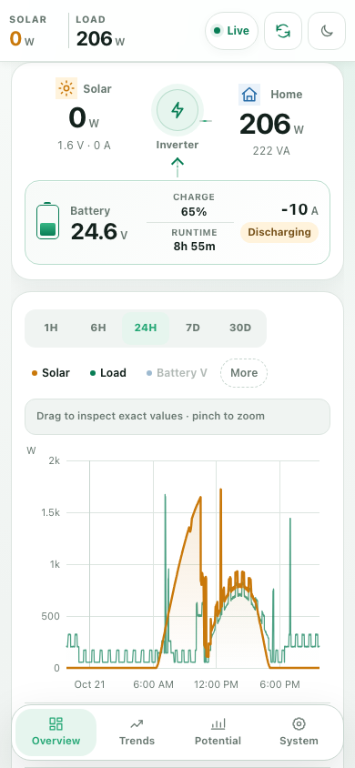
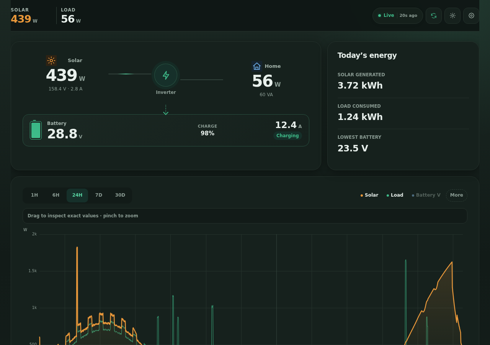
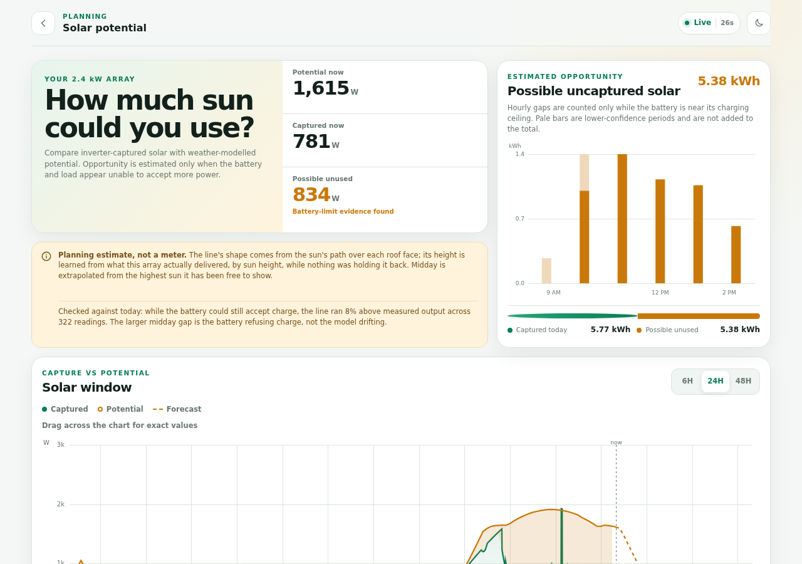
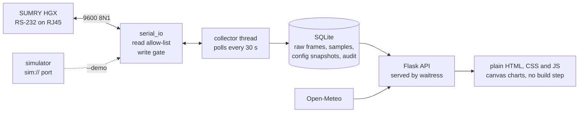

# SUMRY HGX Solar Monitor

[](https://github.com/OWNER/REPO/actions/workflows/ci.yml)


[](LICENSE)

A local-first monitor for a SUMRY HGX 4 kW 24 V off-grid inverter, running on a Raspberry Pi. It speaks the inverter's reverse-engineered RS-232 protocol, keeps every reading in SQLite, tracks the battery bank by counting charge, and learns the solar array's real potential from its own output. No cloud account, no build step, three runtime dependencies.

<p>
  
  
</p>
<p>
  
</p>

*Screenshots are of the built-in simulator (`run.py --demo`), so they show made-up data rather than a real installation.*

## Try it without the hardware

```sh
git clone https://github.com/OWNER/REPO.git solar-monitor && cd solar-monitor
python3 -m venv .venv && .venv/bin/pip install -r requirements.txt
.venv/bin/python run.py --demo
```

Then open <http://127.0.0.1:5000>. The admin portal is at `/admin`, login `demo` / `demo-password`.

`--demo` runs the whole application against a simulated inverter with a week of generated history. The simulation sits below the serial transport, not beside it: `sim://` is a pyserial port, so the collector sends the same allow-listed queries and decodes the same CRC-checked frames it would from the real inverter, and a configuration written from the admin portal must pass the same write gate before the simulated charger follows it. The model behind it is physical rather than recorded: sun position and clear-sky irradiance for the site, weather seeded per day, a household routine, and a 24 V lead-acid bank with a three-stage charger that curtails the panels once it is full.

## What it does

- **Live power flow.** PV, battery, load and utility every 30 seconds, with the inverter's output stage, bus voltage, temperatures and fans.
- **History.** One hour to a day as a canvas chart that you can read, pan and zoom; a week or a month as energy per day. Thinning keeps every column's extremes, so the drawn peaks are the real peaks and agree with the summary tiles.
- **Battery bank health.** State of charge by counting charge, re-anchored when the bank is full (a plateau held at a trickle after a real absorption) and when it rests (under C/50 with no charge current). Each full-to-rest stretch measures the bank's effective capacity, which replaces the nameplate. Pre-dawn voltage, absorption time and tail current are tracked per day as recovery gauges.
- **Time to the low-voltage cutoff.** Hours left at the recent draw, down to the inverter's configured cutoff rather than to empty, with a warning when there is no utility to fall back on.
- **Solar potential.** Sun position for the site, clear-sky irradiance, Open-Meteo cloud cover and transposition onto one or two roof faces. The level is learned per band of sun elevation from the array's own unconstrained output, so the page can show how much a full battery made the inverter leave on the roof, and what rewiring would recover.
- **Utility detection.** The frame carries no trustworthy utility current, so mains use is derived from the transfer relay (the inverter's own output collapses while the load stays) and from the power balance.
- **Admin portal.** Password plus an optional PIN. Serial diagnostics, retention, estimator inputs, an audit log, exports, and Raspberry Pi controls through a scoped sudo helper.
- **Gated inverter writes.** Off by default. A write is the inverter's own configuration block sent back with only allow-listed fields changed, then read back; nothing is reported as applied on the strength of having been sent.
- **Change proposals.** `python -m solar_monitor.propose` queues an intent without touching the port. An admin releases it, or a standing policy that can only narrow what the protocol already allows.

## How it works



One collector thread owns the serial port. Every cycle it sends the status query, stores the raw exchange and the decoded sample; every tenth cycle it also reads and stores the configuration block. Approved configuration changes are applied between polls by that same thread, and the admin portal's diagnostics wait on its lock, so nothing ever shares the line with a poll.

The protocol layer (`solar_monitor/protocols/sumry_8851.py`) validates every frame by its trailing CRC16/MODBUS checksum, decodes the 158-byte status frame and the 104-byte configuration frame through field tables, and exposes exactly two read queries. `serial_io.py` refuses any outbound frame that is not one of them, and sends writes through a separate gate.

Flask serves a JSON API and three pages: the dashboard, the solar potential page and the admin portal. The pages are plain HTML, CSS and JavaScript loaded with `<script>` tags; `chart-core.js` is the one charting implementation both chart pages share. Asset URLs carry the file's modification time, so an update never pairs a new page with a stale cached script.

## Safety model

Polling is read-only. Writes are opt-in, and every write passes three gates before it reaches the port:

1. **Policy.** The writes switch defaults to off. A proposal from tooling is applied without a person only when every field it touches is inside the auto-apply policy, which is off and empty by default.
2. **Writable-field table.** Each field has a byte offset, a scale and the range of the inverter's own menu. Anything outside the table or its range is refused before a frame is built, and a quantity never accepts a switch value.
3. **Frame assertion.** `assert_write_frame` compares the outbound frame with the reply it was built from and rejects any byte that differs outside the writable masks, any wrong length or command, and any bad checksum.

Writes are whole-block rewrites because the inverter has no per-register write: command `0x0010` takes the entire 94-byte configuration block, so the safest possible frame is the block the inverter just sent, re-checksummed, with the requested bytes changed. The collector reads the block again afterwards and reports each requested value as verified or mismatched. Every write, failure and switch flip is audited.

## Engineering notes

Some choices a reviewer may want to find quickly:

- **The register map is treated as a claim, not a fact.** Three labels in the community map turned out to be wrong for this firmware, and each was disproven against data: offset 76 read 0.00 across 4,489 frames while mains carried the house; the "battery type" bits decoded User-defined while the front panel read AGM; register 82 held 4 where the map promised a boolean. [docs/decisions.md](docs/decisions.md) records each rule the code follows and the evidence behind it, including a full front-panel dump that the decoder matches field for field.
- **Retention is decided by a flag, not by searching prose.** Raw frames used to be classified by substrings of their decode notes. Every good frame's note contained "fault" or "not decoded", so no routine frame was ever pruned, while the raw frames of all six configuration writes were. `tests/test_retention.py` uses the decoder's real notes so that cannot pass again.
- **The simulator is a pyserial URL handler** (`solar_monitor/serial_handlers/protocol_sim.py`). The tests run the real collector, transport and write path against it, and it encodes frames through the decoder's own layout table, so the two cannot drift apart.
- **No bundler, and static checks stand in for a browser.** The Pi has no JavaScript engine, so the suite checks that every template supplies the DOM ids its script needs, that scripts balance their brackets and load in order, and, when Node.js is present, parses them with V8 and runs the charting unit tests. `tools/screenshot.py` drives headless Chromium over the DevTools protocol (standard library only) to render every page and report page errors.

## Install on a Raspberry Pi

Wiring first:

- The inverter's RJ45 COMM port is **not Ethernet**. Do not plug it into the Pi's Ethernet port or a network switch.
- Verify the port's RS-232 pinout and levels before connecting. Use a true USB-to-RS232 adapter (not a TTL UART), cross TX and RX as required, connect signal ground, and leave unused pins unconnected.
- Keep the inverter disconnected from mains and PV while assembling or changing the wiring, following its manual.

Then:

```sh
sudo apt update && sudo apt install -y python3-venv avahi-daemon nginx
python3 -m venv .venv && .venv/bin/pip install -r requirements.txt
cp config.example.toml config.toml        # then edit it
sudo usermod -aG dialout "$USER"           # then log out and in
```

Confirm the wiring before running the collector. `--listen-only` transmits nothing; without it the tool sends only the two allow-listed read queries.

```sh
.venv/bin/python diagnostic.py --listen-only --timeout 3
.venv/bin/python diagnostic.py --json-log captures/hgx.jsonl
```

Run it:

```sh
.venv/bin/python run.py --config config.toml          # serves with waitress
.venv/bin/python run.py --config config.toml --dev    # Flask's development server
.venv/bin/python run.py --no-collector                # web UI only, no serial polling
```

Open `http://<pi>:5000`. On first start the log names the `setup-token` file beside the database; visit `/admin/setup?token=<its contents>` to create the admin account.

For a permanent install, `deploy/solar-monitor.service` runs it under systemd (it assumes `/opt/solar-monitor`, a `solar-monitor` service account and `/var/lib/solar-monitor`; adjust to taste), and `deploy/nginx-solar-monitor.conf` puts it on port 80 for every hostname the Pi answers to. After updating the code, restart the service: pages are cached by the running process.

## Configuration

`config.toml` is untracked; copy `config.example.toml`. A file named with `--config` must exist; with no `--config`, `config.toml` is used if present.

| Table | Keys |
| --- | --- |
| `[serial]` | `port` (`"auto"` picks the first USB adapter; `"sim://"` the simulator), `baudrate`, `timeout_seconds`, `poll_seconds`, `protocol`, `require_clock_sync` |
| `[web]` | `host`, `port`, `expose_network_info` |
| `[storage]` | `database` (SQLite path; its directory also holds the secret and setup-token files) |
| `[site]` | `latitude`, `longitude`, `array_capacity_watts`, `performance_ratio`, `tilt_degrees`, `azimuth_degrees`, `dual_slope`, `split_strings`, `array_description`, `module_count`, `module_watts`, `wiring`, `vmp_volts`, `voc_volts`, `imp_amps`, `isc_amps`, `inverter_model`, `charge_limit_amps`, `battery_description`, `battery_nominal_volts`, `battery_capacity_ah` |

`require_clock_sync` (on by default) holds readings back until the clock has been set from the network, because a Pi without a real-time clock boots with a stale one; turn it off on a Pi with a battery-backed RTC that may have no internet.

Every `[site]` key is optional. Without a location and array capacity the estimator is off and the potential page says so. `performance_ratio` is only the fallback until a week of readings exists; after that the level is learned. `dual_slope` splits the array across both faces of a pitched roof; `split_strings` says each series string straddles both faces.

The dashboard needs no login, so `/api/system` leaves out the hostname, address and Wi-Fi network unless `expose_network_info` is set; the admin portal shows them either way. The polling rate, retention windows, chart point cap, estimator inputs, writes switch and auto-apply policy are changed in the admin portal, stored in SQLite, and take effect without a restart. The serial link itself is read from the config file at startup.

## API

<details>
<summary>Public endpoints</summary>

| Method | Path | Returns |
| --- | --- | --- |
| GET | `/`, `/estimate` | dashboard, solar potential page |
| GET | `/api/status` | latest sample with the derived utility state, latest configuration, last raw exchange, collector state |
| POST | `/api/refresh` | one immediate poll, rate-limited to once per 5 seconds |
| GET | `/api/history?hours=N&fields=a,b&points=N` | samples for the last N hours (max 720), optionally only the named columns |
| GET | `/api/history/daily?days=N` | per-day energy, averages, peaks and minimum battery voltage |
| GET | `/api/history/faults?days=N` | rows with a non-empty faults field |
| GET | `/api/battery` | charge count, anchors, measured capacity, runtime to cutoff, 14 days of health |
| GET | `/api/estimate?hours=N` | modelled output for the window plus six hours ahead, calibration, scenarios |
| GET | `/api/system` | Pi uptime, CPU temperature, throttling, eco mode (and network, if exposed) |
| GET | `/health` | process and collector health; 503 when the serial link has gone quiet |

</details>

<details>
<summary>Admin endpoints (session required)</summary>

`/admin/setup`, `/admin/login`, `/admin/pin-login` and `/admin/logout` manage the session.

| Method | Path | Does |
| --- | --- | --- |
| GET | `/admin` | the portal |
| GET | `/api/admin/overview` | serial link, storage counts, disk, system snapshot |
| GET, POST | `/api/admin/settings` | read or change runtime settings |
| POST | `/api/admin/serial/listen`, `/api/admin/serial/probe` | passive capture, or one allow-listed status query |
| GET | `/api/admin/frames?limit=N` | recent raw exchanges |
| POST | `/api/admin/data/cleanup` | run retention now |
| GET | `/api/admin/audit` | recent audit events |
| GET, POST | `/api/admin/security` | PIN status; set or disable the PIN |
| GET | `/api/admin/inverter` | writes switch, current configuration, writable fields, configuration history, proposals, policy |
| POST | `/api/admin/inverter/writes` | switch writes on or off |
| POST | `/api/admin/inverter/settings` | write changed fields and read them back |
| POST | `/api/admin/inverter/restore` | write an earlier configuration back |
| POST | `/api/admin/inverter/requests/<id>/approve`, `.../reject` | decide a proposal |
| POST | `/api/admin/inverter/auto-apply` | switch and edit the auto-apply policy |
| GET, POST | `/api/admin/system/eco` | read or set the CPU governor |
| GET, POST | `/api/admin/system/wifi` | scan, or connect to a network |
| POST | `/api/admin/system/restart-service`, `/api/admin/system/reboot`, `/api/admin/system/update-check` | Pi controls |
| GET | `/api/admin/export/frames.jsonl`, `/api/admin/export/samples.csv` | exports |

</details>

## Raspberry Pi controls

The portal's Raspberry Pi tab can switch the CPU governor, restart the service, reboot, and scan or join Wi-Fi networks. All of these run through one helper, `deploy/pi-control.sh`, which never evaluates its arguments as shell and accepts only a fixed set of actions. A Wi-Fi passphrase reaches it on standard input rather than as an argument, because sudo logs every argument to the system journal. To enable them:

1. Install the helper where the service account cannot change it: `sudo install -o root -g root -m 0755 deploy/pi-control.sh /usr/local/sbin/solar-monitor-pi-control`. The app uses that copy whenever it exists; re-run the command after an update. The sudoers rule grants root to whatever the file contains, which is why it must not be a file the service account can rewrite, such as the copy in a checkout under its home directory.
2. Install the sudoers rule, adjusting the user: `sudo cp deploy/solar-monitor-sudoers.example /etc/sudoers.d/solar-monitor && sudo chmod 440 /etc/sudoers.d/solar-monitor && sudo visudo -c`.
3. Make sure the systemd unit does not set `NoNewPrivileges=true`, which blocks `sudo` whatever sudoers says. The shipped unit leaves it off.
4. Wi-Fi actions need NetworkManager (`nmcli`), the default on Raspberry Pi OS Bookworm and later.

Without this setup the buttons return a clear error instead of hanging.

## Development

```sh
.venv/bin/pip install -r requirements-dev.txt
.venv/bin/python -m unittest discover -v        # the suite; no hardware needed
.venv/bin/ruff check .                           # lint, as CI runs it
node --test tests/js/*.test.js                   # charting unit tests, if Node.js is installed
```

CI runs the suite on Python 3.11, 3.12 and 3.13 with Node available, and ruff as a blocking check.

To look at the pages, run the demo and render them with headless Chromium:

```sh
.venv/bin/python run.py --demo &
.venv/bin/python tools/screenshot.py --out docs/screenshots          # the README's three views
.venv/bin/python tools/screenshot.py --all --login demo:demo-password --out /tmp/shots
```

## Project layout

```text
run.py                                   web server plus background collector; --demo for the simulator
diagnostic.py                            serial discovery and raw capture tool
solar_monitor/config.py                  config.toml loading
solar_monitor/collector.py               polling thread, write path, applying approved proposals
solar_monitor/serial_io.py               guarded 9600 8N1 transport, read allow-list, write gate
solar_monitor/protocols/base.py          protocol interface
solar_monitor/protocols/sumry_8851.py    HGX 0x8851 frames: CRC, field tables, writable fields
solar_monitor/db.py                      SQLite schema, history, retention, proposals, audit
solar_monitor/web.py                     Flask routes: public API and admin portal
solar_monitor/battery.py                 charge counting, anchors, capacity, runtime to cutoff
solar_monitor/utility.py                 utility presence and bypass from the power balance
solar_monitor/solar_estimate.py          sun position, irradiance, roof geometry, learned efficiency
solar_monitor/simulator.py               the simulated inverter, household and bank behind --demo
solar_monitor/serial_handlers/           the sim:// pyserial port
solar_monitor/change_policy.py           auto-apply policy evaluation
solar_monitor/propose.py                 command-line change proposals
solar_monitor/privileged.py              calls into the scoped sudo helper
solar_monitor/system_info.py             Pi uptime, temperature, network, service state, updates
solar_monitor/security.py                secret and setup-token files
solar_monitor/templates/                 dashboard, solar potential, admin and login pages
solar_monitor/static/                    plain CSS and JavaScript; chart-core.js is shared
tools/discover_registers.py              map unknown configuration registers from panel changes
tools/screenshot.py                      render the pages with headless Chromium
deploy/                                  systemd unit, nginx site, sudo helper and rule, example config
tests/                                   protocol safety, models, simulator, API and front-end static checks
tests/js/                                Node unit tests for the charting maths
docs/decisions.md                        why the code is the way it is, with the evidence
```

## Status and known limitations

- The status frame's `operating_state` and `faults` bytes are not identified yet, so the dashboard says "Not decoded" rather than claiming there are no faults.
- Utility current is not in the frame. The utility watts and amps shown are derived from the power balance and are a lower bound, not a metered reading.
- Battery type can be neither read nor written over the protocol; it is set on the inverter's own panel.
- The models were calibrated on one installation: a 24 V AGM bank, a 2.64 kW array split across a gable roof, a desert site. The chemistry curve, anchor thresholds and ground albedo are constants in the code, and the voltage thresholds assume a 24 V bank.

## License

MIT; see [LICENSE](LICENSE).
